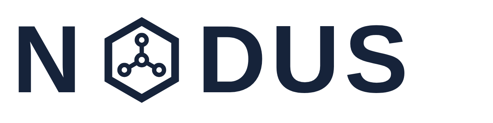

  <picture>
    <source media="(prefers-color-scheme: dark)" srcset="docs/design/logo/Nodus_словесный_знак_белый.png">
    
  </picture>

<strong>Единый контур работы проектной компании: письма, задачи, чаты, согласования и файлы — на собственном сервере.</strong>

  
  
  

**Nodus** (лат. «узел» — конструктивный узел здания и узел графа) — открытый корпоративный портал, который создаётся внутри действующей проектно-строительной компании для замены связки «облачный трекер + бумажная СЭД». Self-hosted и без единого облачного сервиса в рантайме: весь портал и все данные компании остаются на её собственном сервере, разворачивается одной командой `docker compose up`.

## Проблема, которую решаем

В проектной организации рабочий день рассыпан по чужим системам: письма — в СЭД, задачи и чаты — в облачном трекере, файлы — где придётся. Последствия знакомы каждому:

- **двойной ввод** — резолюцию из письма секретарь вручную дублирует задачей в трекере; это главный ежедневный источник потерь и ошибок;
- **подписка и vendor lock-in** — тарифы растут, обновления приходят не тогда, когда удобно вам, а ваши данные живут на чужой инфраструктуре;
- **данные компании не принадлежат ей** — сроки, трудозатраты и история решений оседают в чужом облаке в неструктурированном виде, и использовать их для анализа или ИИ уже невозможно.

Nodus сводит всё в один контур, который принадлежит компании: один сервер, одна база, одна история работы.

## Центральный сценарий

**Письмо → резолюция → поручение → задача с трекингом времени.**

Зарегистрировали входящее письмо, руководитель наложил резолюцию — и поручение уже стало задачей исполнителя: с проектом, сроком и типом работ. Никакого повторного ввода. Дальше портал сам знает, сколько времени ушло на работу, кто из участников задержал ответ и на каком этапе стоит каждая задача.

## Возможности

- **Задачи и проекты** — дерево проектов, типы задач с настраиваемыми маршрутами: статусы, кнопки-переходы, утверждения, обязательные вопросы при закрытии, окна перехода. Учёт трудозатрат, канбан и списки, живые обновления без перезагрузки _(в активной разработке)_.
- **Мессенджер** — диалоги, групповые чаты, каналы и новости с тредами, вложения с мгновенными превью, статусы набора и присутствия. Работает в ежедневной эксплуатации с осени 2026.
- **Корреспонденция** — входящие и исходящие письма, резолюции, поручения, превращающиеся в задачи; связь «письмо ↔ поручение ↔ исполнитель» сохраняется навсегда _(до конца 2026)_.
- **Согласования** — переработки, заявки и другие процессы на декларативных схемах: согласующий решает в карточке, а не в отдельном окне _(до конца 2026)_.
- **Файлы** — S3-хранилище, просмотр офисных документов и PDF прямо в браузере (ONLYOFFICE), серверные превью изображений.
- **Автоматизация** — библиотека типов задач и визуальный редактор маршрутов на едином холсте схем; процессы настраивает администратор в интерфейсе, без разработчика _(в активной разработке)_.
- **Справочники и права** — структура компании, роли и матрица прав по модулям, гибкие справочники; всё на русском деловом языке.
- **Уведомления и десктоп** — приоритеты, журнал доставок и ознакомление; нативный клиент Windows с уведомлениями из трея и быстрым ответом.

## Философия

1. **Данные — главный актив.** Каждый артефакт структурирован, связан с другими и несёт метки времени. Из портала годами растёт корпус данных о реальной работе — трудозатраты, сроки, скорость ответов. На нём строятся будущие ИИ-инструменты: сводки, ассистенты, оценка сроков проектов. Такой корпус нельзя купить и нельзя восстановить задним числом — он либо копится с первого дня, либо его нет.
2. **Свой сервер — свои правила.** Self-hosted, zero cloud: никаких внешних SaaS в рантайме. Где живут ваши данные — решаете вы.
3. **API-first.** Любое действие интерфейса воспроизводимо REST-запросом от имени пользователя. Портал готов к скриптам, интеграциям и ИИ-агентам.
4. **Гибкость настройкой, а не кодом.** Справочники, типы задач, маршруты и права настраиваются в интерфейсе. Модулей «на всякий случай» нет: каждый появляется под реальный процесс.
5. **Один продукт вместо франкенштейна.** Модульный монолит: модули связаны событиями и контрактами, тяжёлая работа уходит в фоновые очереди, интерфейс отвечает мгновенно (оптимистичный UI).
6. **Знакомо инженерам.** География интерфейса повторяет привычные корпоративные порталы, оформление современное, терминология — русская деловая. Переучивание — главный риск таких проектов, и он спроектирован, а не проигнорирован.

## Статус проекта

Nodus — активная разработка, а не продукт «с полки»: портал строится для реального переезда компании-заказчика с Bitrix24 (цель — декабрь 2026), каждый модуль проверяется живой эксплуатацией.

- **Уже в ежедневной работе:** мессенджер, файлы с онлайн-просмотром документов, уведомления, десктоп-клиент, доступ и структура компании.
- **В активной разработке до конца 2026:** задачи и проекты с настраиваемыми маршрутами, автоматизация процессов, корреспонденция, согласования.

План и статус вех — [docs/product/roadmap.md](docs/product/roadmap.md).

## Технологии

TypeScript (strict) · React 19 + Vite · NestJS (Fastify) · PostgreSQL + Prisma · Redis + BullMQ · Socket.IO · S3 (MinIO-совместимое хранилище) · ONLYOFFICE · Docker Compose. Обоснование каждого выбора — в [docs/architecture/](docs/architecture/) и [ADR](docs/adr/).

## Как развивается проект

Код в Nodus пишут **только ИИ-агенты** — под управлением владельца продукта и команды разработки компании; люди и агенты работают по одним правилам ([CONTRIBUTING.md](CONTRIBUTING.md)). Каждое архитектурное решение зафиксировано в ADR, каждая задача и её проверка — в issues, правила для агентов открыты в [AGENTS.md](AGENTS.md). Репозиторий можно читать как открытый учебник того, как строить продукт вместе с агентами. Требования собирались интервью с руководителями заказчика — [docs/product/interviews/](docs/product/interviews/).

## Лицензия

[Elastic License 2.0](LICENSE) — короткая стандартная лицензия модели «source available»: **пользуйся и меняй свободно, не зарабатывай на продукте**.

- ✅ **можно:** развернуть Nodus у себя — организации свободно используют его для внутренней работы, включая коммерческую; изучать, изменять и распространять код;
- ❌ **нельзя:** зарабатывать на самом Nodus — продавать его или предоставлять как платный хостинг/управляемую услугу, скрывать уведомления об авторстве.

Формально это не «OSI open source»: определение открытого ПО запрещает ограничивать поле применения, а мы ограничиваем осознанно. Код при этом полностью открыт.

## Запуск и участие

Поднять портал у себя или влить правку — [CONTRIBUTING.md](CONTRIBUTING.md): требования, быстрый старт локально, набор команд, структура репозитория и правила процесса. Задачи ведутся через GitHub Issues; патчи приветствуются и проходят те же проверки, что и работа агентов.

## Документация

| Раздел                                   | О чём                                                          |
| ---------------------------------------- | -------------------------------------------------------------- |
| [docs/product/](docs/product/)           | Видение, цели продукта, UX-принципы, интервью с руководителями |
| [docs/architecture/](docs/architecture/) | Инварианты, стек, структура репозитория, модель данных, API    |
| [docs/process/](docs/process/)           | Процесс разработки, Definition of Done                         |
| [docs/adr/](docs/adr/)                   | Архитектурные решения (ADR)                                    |
| [docs/mvp/](docs/mvp/)                   | Рабочие планы треков MVP и архив выполненных                   |
| [docs/design/](docs/design/)             | Айдентика: логотипы, направление интерфейса                    |
